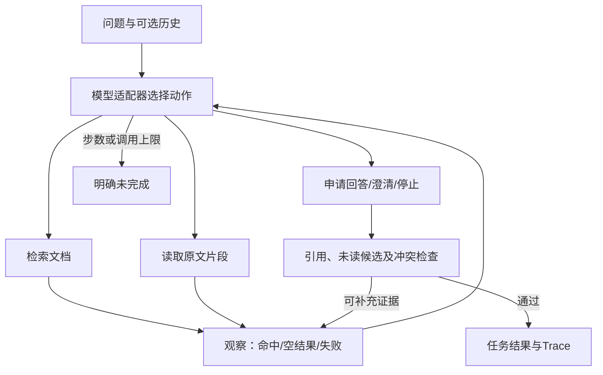

# 技术方案与决策设计

## 结构与取舍

采用原生Python实现轻量有界循环，不引入Agent框架。Pydantic负责输入和动作校验，SQLite FTS5负责本地检索，httpx负责可选真实模型HTTP调用。选择原生循环便于审阅状态转移、工具观察和边界，不把框架默认行为当作动态决策证据。

检索采用中文双字切分、显式同义词归一及FTS5 BM25。小规模合成制度无需向量服务，可完全离线复现；缺点是跨领域语义召回有限，同义词表需维护。

回答采用已读原文摘录和范围说明。模型选择检索词、读取片段、最终引用和停止类型；运行时检查引用存在性、引文一致性及已观察同主题冲突。这样可以核验事实来源，但表达灵活性低于自由生成答案。

## 调用过程

## 动作与观察

每步仅允许一个动作：`search_documents(query, top_k)`、`read_passage(passage_id)` 或 `finish(status, citations, question, gaps)`。动作还带一句简短理由，供审阅，不是模型内部思维链。

观察由运行时生成，含工具名、调用参数、成功/失败、结果摘要。下一次适配器调用收到此前全部动作和观察。工具失败不会在业务工具内部隐式自动重试，由适配器决定换检索词、读其他证据或停止。

API传输层另设最多2次尝试，仅处理网络错误及429/502/503/504；每次尝试进入HTTP元信息。它不改变业务工具状态、不被当作ReAct证据。鉴权、余额、无效JSON和截断动作不以自动重试掩盖。

默认最多8个决策步骤、6次工具调用；输入与原文长度、top_k和模型输出长度均设上限。达到上限输出limit_reached，不输出已回答。

## 模型适配

- `mock`：明确标记的离线规则适配器，读取当前观察后生成动作，不依赖预录制的成功Trace。用于流程验证；不是语言模型。
- `live`：兼容OpenAI风格Chat Completions的HTTP接口，通过本地环境变量配置模型、地址和密钥，也可用`--api-key-file`读取项目外单行密钥。已接入DeepSeek的deepseek-flash；实际验收结果见评估文档。业务资料及工具观察作为不可信数据传入，动作必须通过相同校验。

历史消息使用正式user/assistant角色传给真实模型，当前问题与本轮工具观察放在最后一条user消息中。历史仅用来理解主题，不能直接作为最终引用来源。身份词和业务主题分开：只有对象而无申请事项、且历史无法补全时先澄清。

DeepSeek结构化动作请求显式使用`thinking=disabled`和JSON输出；记录响应ID、模型名、HTTP状态、token用量、finish_reason及耗时。不记录reasoning_content或请求头。输出截断时返回失败，不能当作有效动作。

Trace中记录适配器模式；真实模型异常不得自动降级成Mock以继续冒充真实成功。

## 引用和冲突

检索结果提供文档ID、片段ID、版本、主题和简短摘录；只有读取工具返回的原文才能用于最终引用。运行时要求引用ID存在于本轮读取集合，引用文字必须是原文的连续片段。

同主题、适用范围未决、事实值不同的已读片段构成冲突。日期更新不能自动表示旧制度失效。同主题搜索候选尚未读完时，先给适配器补读提示，避免看见冲突候选却只引用一方。原文有明确不同适用范围时保留范围，不自行把某条规则用于所有员工。

无依据状态也有校验：没有成功执行过检索时，不能结束为insufficient_evidence。运行时返回补查观察，让模型先查资料；若工具一直失败则应保留tool_error。

有限域事实标注辅助冲突识别；没有标注、没有检索到或没有纳入当前资料的冲突仍可能遗漏，评估文档会保留这一限制。

## 失败、Trace和敏感信息

工具异常结构化返回，真实接口异常返回model_error。无结果可重写查询或停止；缺适用范围需澄清；冲突列双方原文；上限中断明确未完成。

Trace为JSONL，每条含序号、事件类型、动作、参数、观察或最终状态。只记录合成资料、简短理由、结构化结果；不记录密钥、HTTP请求头或模型隐藏思维。文件只写入用户指定的结果路径，无真实发布动作。

每轮真实验收独立归档，初次失败、定向复测和全套回归均保留。源码SHA-256在真实验收启动时记录，交付前核对是否仍与当前文件一致。密钥文件留在项目目录之外，提交核对脚本逐字节扫描项目，检查实际密钥是否进入产物。
